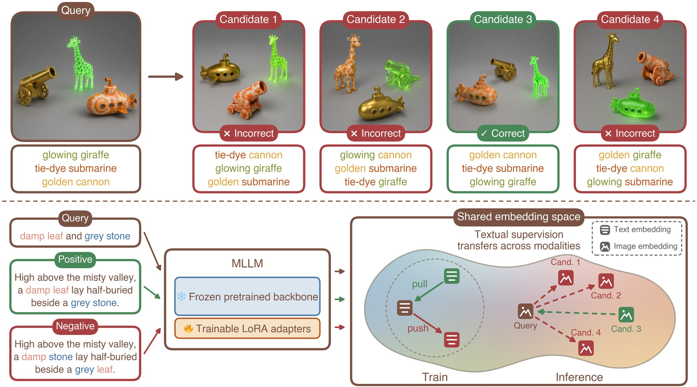

<h1 align="center">Stuck on Shuffle: On Attribute-Objects<br>Binding in Vision-Language Models</h1>

<p align="center">
  <a href="https://stuck-on-shuffle.github.io"><b>Project Page</b></a> &nbsp;|&nbsp;
  <!-- TODO: add the arXiv link when available -->
  <a href=""><b>arXiv</b></a> &nbsp;|&nbsp;
  <a href="https://huggingface.co/datasets/NetanelTamir/Stuck-On-Shuffle-SABER"><b>SABER Benchmark</b></a> &nbsp;|&nbsp;
  <a href="https://huggingface.co/datasets/NetanelTamir/Stuck-On-Shuffle-Finetuning-Dataset"><b>Finetuning Dataset</b></a>
</p>

<p align="center">
  <a href="https://netanel-tamir.github.io/">Netanel Y. Tamir</a><sup>1</sup>,
  <a href="https://www.linkedin.com/in/michael-green-0631b051/">Michael Green</a><sup>1</sup>,
  <a href="https://www.linkedin.com/in/issar-tzachor/">Issar Tzachor</a><sup>1</sup>,
  <a href="https://www.linkedin.com/in/or-shimshi-6a9a34/">Or Shimshi</a><sup>1</sup>,<br>
  <a href="https://dvirsamuel.github.io/">Dvir Samuel</a><sup>2</sup>,
  <a href="https://orpatashnik.github.io/">Or Patashnik</a><sup>3</sup>,
  <a href="https://www.benarirami.com/">Rami Ben-Ari</a><sup>1</sup>
</p>

<p align="center">
  <sup>1</sup> OriginAI &nbsp;&nbsp; <sup>2</sup> NVIDIA &nbsp;&nbsp; <sup>3</sup> Tel Aviv University
</p>

<p align="center">
  
</p>

## Contents

1. [Environment](#1-environment)
2. [Datasets](#2-datasets)
   - [SABER](#saber)
   - [Finetuning triplets](#finetuning-triplets)
3. [Models](#3-models)
   - [Loading and embedding](#loading-and-embedding)
4. [Demo notebook](#4-demo-notebook)
5. [Acknowledgements](#acknowledgements)

## 1. Environment

Python 3.11 and an NVIDIA GPU (CUDA) or an Apple silicon Mac (MPS); CPU works for text embedding
of the 2B models but is slow. `transformers >= 5.9` is required: the WeMM and UEmbed backbones are
`qwen3_5` models that older releases do not include.

```bash
git clone https://github.com/Netanel-Tamir/Stuck-On-Shuffle.git
cd Stuck-On-Shuffle
python -m venv .venv && source .venv/bin/activate
pip install -r requirements.txt
```

The 2B models run on a 24 GB card. The 8B/9B models take about 20 GB for weights in bfloat16 plus
activations. On a Mac the same numbers apply to unified memory, so the 8B/9B models need a 32 GB or
larger machine. The loader picks CUDA, then MPS, then CPU automatically; pass `device=` to override.

## 2. Datasets

### SABER

A benchmark for attribute-object binding in vision-language models, covering all four text and
image modality pairings (text–text, text–image, image–text, and image–image). Scenes contain 2 to
10 objects, built from 232 everyday objects and 50 visual attributes. Each of the 1,800
multiple-choice questions has a query and four candidates, all given both as an image and as a
caption; the candidates contain exactly the same objects and attributes as the query, and only one
keeps each attribute on the right object. The benchmark is structured as multiple-choice questions,
but the candidates can also be pooled into a single gallery for large-scale retrieval evaluation.

**Files.** Nine CSVs, `2_objects.csv` to `10_objects.csv`, 200 rows each (one per number of objects
in the scene), plus 9,000 PNGs (1024 x 1024) under `images/<n>_objects/`, named `<id>_query.png`
and `<id>_ans_<k>.png`.

| column | content | example (`2_objects.csv`, row 0) |
|---|---|---|
| `id` | row index within the file | `0` |
| `query_img` | repo-relative path of the query image | `images/2_objects/0_query.png` |
| `query_txt` | query caption | `A sandy snowboard and a pink cherry.` |
| `ans_k_img` (k = 1..4) | candidate image paths | `images/2_objects/0_ans_1.png` |
| `ans_k_txt` (k = 1..4) | candidate captions | `A pink cherry and a sandy snowboard.` |

**Candidates.**

| candidate | construction |
|---|---|
| `ans_1` | **correct**: the query's bindings, with the pairs in a different order |
| `ans_2` | attributes permuted across the objects |
| `ans_3` | objects permuted across the attributes |
| `ans_4` | both permuted (for 2 objects, where only two assignments exist: one pair replaced by a fresh object or attribute) |

Per object count, rows 0 to 99 are sampled independently and rows 100 to 199 form nested chains:
the N-object query contains the (N-1)-object query of the same index plus one more pair.

**Loading.**

```python
from stuck_on_shuffle import load_saber, saber_image, download_saber_images

saber = load_saber()                     # all 1,800 rows, with an n_objects column
saber = load_saber(n_objects=[2, 3])     # or a subset of object counts

row = saber.iloc[0]
img = saber_image(row.query_img)         # downloads just that PNG, returns a PIL image
print(row.query_txt, "|", row.ans_1_txt)

root = download_saber_images()           # bulk: all CSVs + images (about 11 GB), returns local root
```

**Evaluation.** Two complementary protocols, each run in all four modality pairings. Both snippets
below use text queries against image candidates; swap `embed_texts` / `embed_images` and the `txt` /
`img` columns for the other pairings.

*Multiple choice.* For each question, we score the similarity between the query and each of its
four candidates and select the highest-scoring candidate. The prediction is correct if `ans_1` ranks
first. Because all four candidates contain the same objects and attributes and differ only in their
attribute–object assignments, success requires distinguishing the bindings. We report accuracy for
each setting as the unweighted mean across the nine object counts; chance performance is 25%.

```python
import os, torch
from stuck_on_shuffle import load_saber, download_saber_images, load_model, mcq_accuracy, ANSWERS

saber = load_saber()
root  = download_saber_images()
model = load_model("qwen3vl-embedding-8b")

acc = {}
for n, df in saber.groupby("n_objects"):
    q = model.embed_texts(df.query_txt.tolist())                                   # (rows, d)
    c = torch.stack([model.embed_images([os.path.join(root, p) for p in df[f"{a}_img"]])
                     for a in ANSWERS], dim=1)                                     # (rows, 4, d)
    sims = torch.einsum("nd,nkd->nk", q, c)                                        # (rows, 4)
    acc[n] = mcq_accuracy(sims)                                                    # ans_1 must rank first

print({n: round(a, 3) for n, a in acc.items()})
print("T2I accuracy:", round(sum(acc.values()) / len(acc), 4))
```

`scripts/eval_saber_mcq.py` runs this for all four pairings at once.

*Large-gallery retrieval.* We pool the candidates from all questions into a single gallery of 7,200
items (four candidates for each of 1,800 questions across all object counts). Each of the 1,800
queries then ranks the full gallery by similarity. A gallery item is considered positive if it
contains all attribute–object bindings in the query, even if it includes additional bindings. Items
containing the same objects and attributes but different bindings serve as hard negatives. We report
mean average precision (mAP), separately for the two halves of each CSV:

| subset | rows | positives |
|---|---|---|
| independent | `id` 0 to 99 | exactly one: the question's own `ans_1` |
| nested | `id` 100 to 199 | the question's own `ans_1`, plus the `ans_1` items of the same chain at larger object counts, whose scenes contain the query's bindings inside a bigger scene |

`saber_gallery` pools the candidates (7,200 rows with `n_objects`, `id`, `role`, `img`, `txt` and
the parsed `bindings`), `saber_queries` returns the 1,800 queries with a `subset` column, and
`retrieval_positives` applies the subset-containment rule.

```python
import os
from stuck_on_shuffle import (load_saber, saber_queries, saber_gallery, retrieval_positives,
                              mean_average_precision, download_saber_images, load_model)

saber   = load_saber()
queries = saber_queries(saber)                              # 1,800 rows, subset column
gallery = saber_gallery(saber)                              # 7,200 rows: all candidates pooled
root    = download_saber_images()
positives = retrieval_positives(queries, gallery)           # (1800, 7200) bool

model = load_model("qwen3vl-embedding-8b")
q = model.embed_texts(queries.txt.tolist())                                   # text queries
g = model.embed_images([os.path.join(root, p) for p in gallery.img])          # image gallery
sims = model.similarity(q, g).numpy()

for subset in ["independent", "nested"]:
    m = (queries.subset == subset).values
    print(subset, "T2I mAP:", round(mean_average_precision(sims[m], positives[m]), 4))
```

`scripts/eval_saber_retrieval.py` runs this for all four pairings and both subsets at once.

### Finetuning triplets

100,000 text-only triplets for teaching multimodal embedding models attribute-object binding. Every
row pairs a short query with a caption that expresses the same bindings and two hard negatives that
reuse exactly the same words with the bindings shuffled.

**Files.** One file, `finetuning_dataset.csv`.

| column | content | example |
|---|---|---|
| `id` | row index, 0 to 99,999 | `40000` |
| `triplet_type` | the sentence template the row was generated with (see below) | `pair_swap` |
| `query` | a short phrase naming two or three attribute-object pairs | `antique table and wooden bench` |
| `positive` | a longer caption that expresses the same bindings, embedded in context | `Surprisingly, the wooden bench sat near where the antique table stood while a chilly breeze blew across the yard.` |
| `swapped_attributes` | the positive with the **attributes** exchanged between the objects | `Surprisingly, the antique bench sat near where the wooden table stood while a chilly breeze blew across the yard.` |
| `swapped_objects` | the positive with the **objects** exchanged between the attributes | `Surprisingly, the wooden table sat near where the antique bench stood while a chilly breeze blew across the yard.` |

**Templates (`triplet_type`).**

| `triplet_type` | rows | how the bindings are expressed |
|---|---|---|
| `pair_swap` | 20,000 | two attributed objects in one sentence (`the wooden bench ... the antique table`) |
| `attr_bundle` | 20,000 | each object carries a bundle of attributes (`a thick stone pillar and a bulky granite statue`) |
| `predicative` | 20,000 | attributes stated predicatively (`the ticket was crumpled ... the poster had gone faded`) |
| `triple_bind_swap` | 9,952 | three pairs; the negatives swap two of them |
| `triple_bind_cycle` | 10,048 | three pairs; the negatives rotate all three cyclically |
| `deferred_bind_anaphoric` | 9,417 | objects are introduced first, attributes attached later via *the former / the latter* |
| `deferred_bind_respective` | 10,583 | objects are introduced first, attributes attached later via *respectively* |

**Extracting training triplets.** Each row yields two triplets with a shared anchor and positive:

```
(query, positive, swapped_attributes)
(query, positive, swapped_objects)
```

The query is the anchor, the positive is the caption that must be pulled toward it, and each
negative is a caption that must be pushed away, using a margin triplet loss on the cosine
similarities of L2-normalised embeddings.

**Loading.**

```python
from stuck_on_shuffle import load_finetuning_dataset

triplets = load_finetuning_dataset()     # DataFrame, 100,000 x 6
triplets.triplet_type.value_counts()
```

## 3. Models

Six LoRA adapters (rank 4, alpha 4, on the `q/k/v/o` projections of the language decoder) on top of
three public embedding-model families. All are epoch-1 checkpoints trained with a margin triplet
loss on the triplets above, with LiNeS layer scaling already **baked into the adapter weights**
(`lines.json` in each folder). Load them with the normal PEFT API and do not scale the layers again.
See [`checkpoints/README.md`](checkpoints/README.md).

| name | base model | SABER overall, base → finetuned |
|---|---|---|
| `qwen3vl-embedding-8b` | [Qwen/Qwen3-VL-Embedding-8B](https://huggingface.co/Qwen/Qwen3-VL-Embedding-8B) | 0.52 → 0.84 |
| `qwen3vl-embedding-2b` | [Qwen/Qwen3-VL-Embedding-2B](https://huggingface.co/Qwen/Qwen3-VL-Embedding-2B) | 0.41 → 0.56 |
| `wemm-embedding-9b` | [tencent/WeMM-Embedding-9B](https://huggingface.co/tencent/WeMM-Embedding-9B) | 0.48 → 0.75 |
| `wemm-embedding-2b` | [tencent/WeMM-Embedding-2B](https://huggingface.co/tencent/WeMM-Embedding-2B) | 0.42 → 0.61 |
| `uembed-9b` | [Alibaba-NLP/UEmbed-9B](https://huggingface.co/Alibaba-NLP/UEmbed-9B) | 0.51 → 0.73 |
| `uembed-2b` | [Alibaba-NLP/UEmbed-2B](https://huggingface.co/Alibaba-NLP/UEmbed-2B) | 0.42 → 0.62 |

SABER overall is the mean multiple-choice accuracy over the four modality pairings (text–text,
text–image, image–text, image–image) and nine object counts; chance is 0.25.

### Loading and embedding

```python
from stuck_on_shuffle import load_model, list_models

print(list_models())
model = load_model("qwen3vl-embedding-8b")          # downloads the base, attaches the adapter

texts  = model.embed_texts(["A red mug and a blue kettle.",
                            "A blue mug and a red kettle."])   # (2, d) float32, L2-normalised
images = model.embed_images(["scene.png"])                     # paths, URLs or PIL images -> (1, d)

sims = model.similarity(texts, images)                         # cosine matrix (2, 1)
```

* Inputs are batched internally (`batch_size=` on both methods).
* Embeddings are L2-normalised, so cosine similarity is a plain dot product.
* Text is truncated at 512 tokens and images use the 8,192-token budget, weights are bfloat16 on
  CUDA and MPS (float32 on CPU): the exact inference path used to produce the numbers in the table.
  If your MPS build rejects bfloat16, pass `dtype=torch.float16`.
* `instruction=` overrides the model's default task prompt. Leave it unset to match the released
  results.
* `load_model(..., device="mps")` (or `"cuda"`, `"cpu"`) selects the device;
  `base_model="/local/dir"` uses a local copy of the base model; `merge_lora=True` folds the
  adapter into the base weights.

The frozen base model can be scored from the same weights in memory, which is how the demo compares
the two:

```python
with model.without_adapter():
    base_emb = model.embed_texts(texts)      # original base model
ours_emb = model.embed_texts(texts)          # finetuned
```

## 4. Demo notebook

[`demo.ipynb`](demo.ipynb) runs through everything above with outputs included: it browses both
datasets, shows SABER questions as images and captions, loads a finetuned model, compares it with
its base on a handful of questions in all four settings, and reproduces the full text-to-text SABER
accuracy without downloading any images. Run it from the repository root:

```bash
jupyter notebook demo.ipynb
```

## Acknowledgements

The base models are released by their authors under their own licences:
[Qwen3-VL-Embedding](https://huggingface.co/Qwen/Qwen3-VL-Embedding-8B),
[WeMM-Embedding](https://huggingface.co/tencent/WeMM-Embedding-9B) and
[UEmbed](https://huggingface.co/Alibaba-NLP/UEmbed-9B). The embedding wrappers follow
the official Qwen3-VL-Embedding inference code.